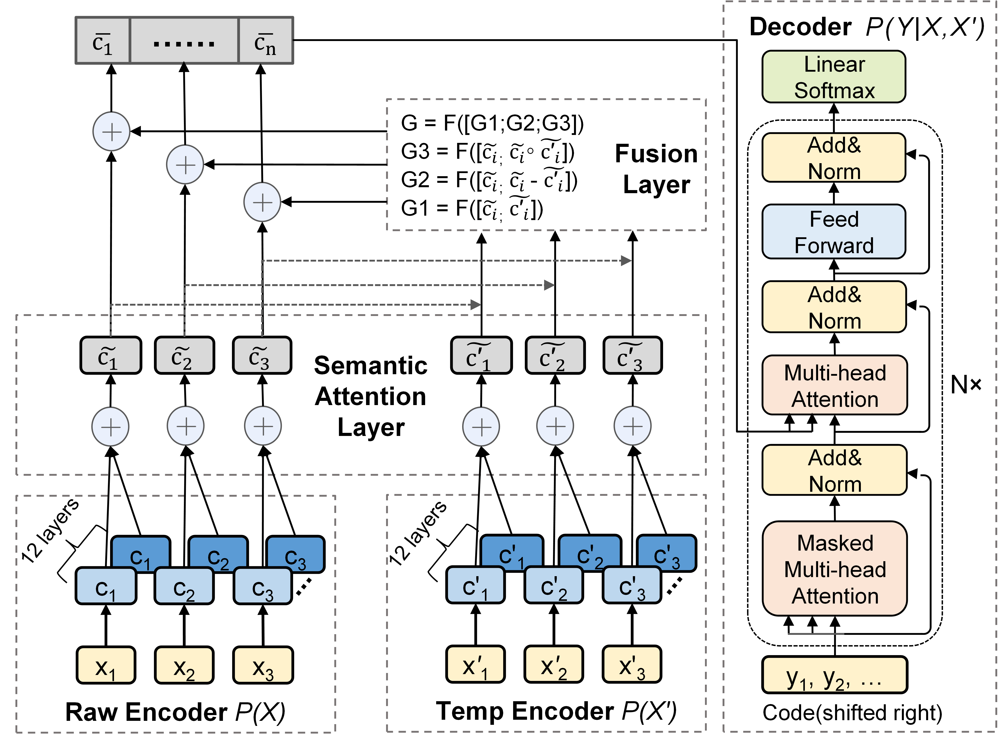

# ExploitGen

Code for paper(under review)  "ExploitGen: Template-Augmented Exploit Code Generation Based on CodeBERT"



The detailed code and training scripts will be given after the acceptance of the paper.

---

## Checkpoint đã train (NT521 reproduction)

Checkpoint `pytorch_model.bin` cho cả 2 ngôn ngữ (assembly + python) được train lại bằng
`codebert-base`, tải tại:

https://drive.google.com/drive/u/1/folders/1O8zQErtFQhsLnKJf3-DzpALjpszzNrb6

Mỗi file ~1.17GB nên không commit lên GitHub. Sau khi tải, đặt vào:
```
ExploitGen/runs/assembly/checkpoint-best-rouge/pytorch_model.bin
ExploitGen/runs/python/checkpoint-best-rouge/pytorch_model.bin
```